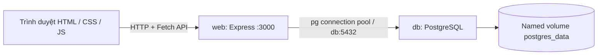

# Student Academic Management System

**Hệ thống quản lý sinh viên và điểm học tập** — sản phẩm Website, Database và Docker cho **Đề tài 20: Thiết kế hệ thống giám sát và tối ưu hiệu năng máy chủ**, môn Nhập môn Công nghệ nền tảng.

Giao diện tiếng Việt có dashboard, danh sách phân trang, tra cứu mã sinh viên, hồ sơ, bảng điểm và GPA theo tín chỉ trên thang 10. Tất cả dữ liệu học tập đến từ PostgreSQL qua REST API; không dùng dữ liệu giả ở frontend. Dữ liệu trong database là dữ liệu **giả lập**, không phải thông tin cá nhân thật.

Ứng dụng dùng Node.js **24.14.1 LTS**, Express **5.2.1**, pg **8.20.0**, PostgreSQL **17.9**, HTML/CSS/JavaScript thuần. Dependency có lockfile, image ghim phiên bản, không ORM/React/Redis. Mặc định **200.000 sinh viên, 40 môn, 1.200.000 bản ghi điểm**.

**Trạng thái bàn giao là BASELINE:** cố ý chưa có index hay UNIQUE trên `students.student_code`; chỉ `students.id` là PK. Nhóm đo tìm kiếm trước, sau đó người phụ trách tối ưu tự tạo `idx_students_code` và đo lại. Index `grades(student_id)` luôn có. Đây là thí nghiệm có kiểm soát; production thực tế nên có ràng buộc duy nhất cho mã sinh viên và xác thực/phân quyền phù hợp.

Các thành viên tiếp nhận qua [tài liệu bàn giao](docs/HANDOFF_FOR_TEAM.md) và [API](docs/API_REFERENCE.md).

**Phần đo tải và giám sát** (thêm sau bàn giao, tách riêng khỏi ứng dụng web):

| Thư mục / file | Nội dung |
|---|---|
| [`load-test/`](load-test/README.md) | Kịch bản k6 `test.js`, `chay_do.ps1` (chạy một lần đo, ghi nhật ký), `phan_tich.py` (TB/SD/CV, so sánh trước/sau, biểu đồ), `phan_tich_tien_trinh.py` (số liệu theo tiến trình). [Giải thích chi tiết test.js](load-test/GIAI_THICH_test_js.md) |
| [`monitoring/`](monitoring/README.md) | Docker Compose cho node-exporter + Prometheus + Grafana trên server; `monitor.sh` ghi tài nguyên mỗi giây; `proc_monitor.sh` ghi CPU/%wait/I/O theo tiến trình và container |
| [`results/`](results/README.md) | Kết quả 18 lần đo trước/sau index, bảng thống kê, biểu đồ KT2/KT3, KT1, số liệu tiến trình (`results/tien_trinh/`) |
| [`docs/DEMO_SCRIPT.md`](docs/DEMO_SCRIPT.md) | Kịch bản demo từng bước: câu lệnh, để làm gì, kết quả mong đợi |

### Thành viên nhóm (Đề tài 20)

| Vai trò | Họ và tên | Mã sinh viên | Phần việc |
|---|---|---|---|
| SV1 | SV1 (họ tên) | 1 | Thiết kế benchmark và tiêu chí: `load-test/test.js`, pilot, chọn 3 mức tải |
| SV2 | SV2 (họ tên) | 2 | Dựng máy chủ và thu số liệu nền: EC2, Docker, `monitoring/`, `monitor.sh`, `proc_monitor.sh` |
| SV3 | SV3 (họ tên) | 3 | Áp dụng cải tiến có bằng chứng: EXPLAIN, `idx_students_code`, phân tích tiến trình |
| SV4 | SV4 (họ tên) | 4 | Lặp phép đo, thống kê và phản biện: `chay_do.ps1`, 18 lần đo, `phan_tich.py` |

### Phiên bản đã dùng khi đo (19/11/2026)

| Thành phần | Phiên bản / cấu hình |
|---|---|
| Máy chủ | AWS EC2 t3.small (2 vCPU Xeon 8259CL, 1,9 GB RAM, EBS 20 GB), Ubuntu 24.04.5 LTS, kernel 7.0.0-1017-aws |
| Container | Docker 29.10.0, Compose v5.7.1; `postgres:17.9-bookworm`; `student-performance-web:1.0.0` (Node.js 24.14.1, Express 5.2.1, pg 8.20.0) |
| Giám sát | node-exporter v1.8.2, Prometheus v2.53.2, Grafana 11.2.0, sysstat 12.6.1 |
| Máy khách | Windows 11, i7-12700H, 16 GB RAM, Wi-Fi; k6 v2.4.0; Python 3.13.3 + pandas 3.0.6, numpy 2.5.3, matplotlib 3.11.2, openpyxl 3.1.5 |

### Dựng lại và chạy kiểm thử (tóm tắt)

```bash
# Máy chủ: ứng dụng (chi tiết ở các mục 2–7 bên dưới)
docker compose up -d --build --wait && bash scripts/seed.sh
bash scripts/functional-check.sh && bash scripts/db.sh validate      # KT1
# Máy chủ: giám sát (chi tiết monitoring/README.md)
cd monitoring && echo "GF_ADMIN_PASSWORD=$(openssl rand -hex 8)" > .env && docker compose up -d
sudo apt install -y sysstat && cp monitor.sh proc_monitor.sh ~/ && chmod +x ~/monitor.sh ~/proc_monitor.sh
```
```powershell
# Máy khách (thư mục load-test): một lần đo, rồi phân tích
.\chay_do.ps1 -TrangThai truoc -VUS 50 -Lan 1      # bật ~/monitor.sh truoc_50vu_lan1_mon.csv trên máy chủ trước
py -3.13 phan_tich.py
```
```bash
# Máy chủ: cải tiến và quay lại trạng thái gốc
bash scripts/db.sh create-index && bash scripts/db.sh validate -v expected_mode=optimized
bash scripts/db.sh drop-index && bash scripts/db.sh validate
```
Sơ đồ hệ thống: [`docs/so_do_he_thong.png`](docs/so_do_he_thong.png). Dữ liệu đo gốc (k6 CSV, monitor CSV, pidstat; khoảng 230 MB) nộp riêng trong gói `DE20_du_lieu_goc.zip`, không đưa lên Git.

<a id="linux-quickstart"></a>

## Dành cho người nhận dự án trên máy Linux — bắt đầu tại đây

**Máy triển khai của người nhận là Linux.** Các bước dưới đây dùng được cho máy Ubuntu có giao diện hoặc Ubuntu Server/VPS. Mac chỉ là máy phát triển ban đầu, không phải yêu cầu của dự án. Bạn không cần chép thư mục Docker hay cài Node.js/PostgreSQL riêng trên máy Linux; Docker tạo hai môi trường chạy này từ source.

Phần cài Docker chi tiết viết cho **Ubuntu 22.04/24.04 LTS 64-bit**. Chạy `cat /etc/os-release` để biết bản Linux đang dùng. Nếu là Debian, Fedora hoặc bản khác, chọn [hướng dẫn Docker đúng hệ điều hành](https://docs.docker.com/engine/install/) thay vì chạy các lệnh thêm repository Ubuntu; sau khi Docker và Compose đã sẵn sàng, tiếp tục các bước clone/build/seed trong tài liệu này.

### Bước 1 — Chuẩn bị Docker trên máy Linux

Làm theo [mục 2: cài đặt và quyền chạy Docker](#linux-prerequisites). Chỉ chuyển sang bước 2 khi `docker info` chạy được bằng tài khoản hiện tại và `docker compose version` trả phiên bản. Các lệnh dưới đây chạy trong Terminal của **máy Linux sẽ chứa Website**; không cần chạy trên máy Mac của người viết.

### Bước 2 — Tải code và tạo cấu hình riêng

```bash
git clone --branch codex/student-academic-management https://github.com/LinhMarky/server-performance-monitoring.git student-performance-system
cd student-performance-system
cp .env.example .env
chmod 600 .env
openssl rand -hex 32
nano .env
```

Dán chuỗi vừa sinh vào dòng `POSTGRES_PASSWORD=`, thay toàn bộ `CHANGE_ME_TO_A_STRONG_PASSWORD`. Trong nano, lưu bằng **Ctrl+O**, **Enter**, rồi thoát **Ctrl+X**. Lần chạy đầu giữ các giá trị còn lại: `DB_HOST=db`, `STUDENT_COUNT=200000`, `DB_POOL_MAX=10`, `WEB_PORT=3000`, `WEB_BIND_ADDRESS=127.0.0.1`. Xem ý nghĩa từng biến ở [mục 3](#clone-and-configure).

Đây là quy trình cho máy mới. Nếu thư mục hoặc `.env` đã tồn tại, dùng lại cấu hình hiện có, không clone hay chép đè `.env` lần nữa.

### Bước 3 — Khởi động, tạo dữ liệu và kiểm tra

Chạy lần lượt tại thư mục `student-performance-system`. Nếu một lệnh lỗi, xử lý lỗi đó trước khi chạy lệnh tiếp theo.

```bash
docker compose config --quiet
docker compose up -d --build --wait --wait-timeout 180
docker compose ps
bash scripts/seed.sh
bash scripts/db.sh validate
bash scripts/functional-check.sh
curl -fsS http://127.0.0.1:3000/api/stats
```

Kết quả cần thấy: hai service `web`, `db` healthy; seed báo thành công; validate báo PASS; functional check báo **8 nhóm đạt**; API stats trả:

```json
{"total_students":200000,"total_subjects":40,"total_grades":1200000}
```

Seed chỉ chạy một lần cho DB mới. Những lần bật lại dùng `docker compose up -d --wait`; không seed lại. Nếu đã có dữ liệu, script seed từ chối ghi đè là hành vi đúng. [Mục 5](#seed-and-check) giải thích cách đổi quy mô/reset có chủ đích; [mục 10](#troubleshooting) xử lý lỗi thường gặp.

### Bước 4 — Mở Web và bàn giao cho người kiểm thử

Mở `http://localhost:3000` **trên chính máy Linux vừa chạy Docker**. Thử mã `SV0150000`, rồi chọn Xem bảng điểm. Nếu dùng máy khác để xem Web hoặc chạy k6, làm theo [mục truy cập mạng](#linux-network) để chọn IP/bind/firewall; localhost trên máy khác không trỏ về máy Linux này.

Khi các bước trên đạt, gửi nhóm địa chỉ Web/API và `benchmark-data/student-codes.json`. Endpoint tải chính là `GET /api/students/search?code=SV0150000`. Giữ BASELINE, chưa chạy create-index trước khi nhóm đo xong lượt ban đầu.

**Muốn hiểu code trước khi vận hành:** đọc [cấu tạo và vai trò từng file](#architecture) bên dưới. **Chỉ cần triển khai:** hoàn thành bốn bước trên rồi đọc [bàn giao theo vai trò](docs/HANDOFF_FOR_TEAM.md). Các mục còn lại là tài liệu tra cứu khi cần đổi cấu hình, backup hoặc kiểm tra index.

<a id="architecture"></a>

## 1. Kiến trúc và cấu trúc



Hai container `web`, `db` cùng mạng Compose. Express phục vụ frontend lẫn API; DB không publish cổng ra host/Internet. Volume giữ dữ liệu độc lập với image Web. Không seed, xóa dữ liệu hoặc tạo index tìm kiếm khi khởi động/restart.

### Web hoạt động như thế nào?

Khi người dùng nhập mã `SV0150000`, JavaScript trong trình duyệt gửi Fetch đến `/api/students/search?code=SV0150000`. Express kiểm tra mã, dùng connection pool gửi một câu SELECT đến PostgreSQL, rồi trả JSON. JavaScript dùng JSON đó để hiển thị hồ sơ và thời gian phản hồi. Khi người dùng chọn bảng điểm, một API khác đọc thêm `grades` và `subjects` để trả các điểm và GPA.

Database có ba bảng: `students` lưu hồ sơ; `subjects` lưu tên môn và tín chỉ; `grades` nối sinh viên với môn học, lưu điểm và học kỳ. Số liệu không nằm cứng trong HTML. PostgreSQL giữ dữ liệu trong named volume, còn source trong Git chỉ chứa schema và công thức seed.

| Thành phần/file | Nhiệm vụ | Người triển khai Linux cần làm gì? |
|---|---|---|
| `frontend/index.html`, `styles.css`, `app.js` | Bố cục, giao diện, điều hướng và gọi API | Docker phục vụ sẵn, không cần build frontend riêng |
| `backend/src/server.js` | Mở HTTP server và đóng kết nối khi dừng | Không cần sửa để đổi hệ điều hành |
| `backend/src/app.js`, `routes/` | Phục vụ frontend, nhận request, trả JSON | Xem API_REFERENCE để biết endpoint |
| `backend/src/db.js`, `config/` | Tạo pool và đọc biến cấu hình DB | Cấu hình qua `.env` |
| `database/schema.sql`, `seed.sql` | Tạo bảng và sinh dữ liệu lớn bằng SQL | Schema tạo lúc volume mới; seed bằng lệnh riêng |
| `database/explain.sql`, `create-index.sql`, `drop-index.sql` | Kiểm tra plan và chuyển trạng thái index | Chỉ chạy theo kế hoạch thí nghiệm của nhóm |
| `Dockerfile` | Đóng gói Node, dependencies, Backend và Frontend thành image Web | Build bằng Docker Compose |
| `docker-compose.yml` | Kết nối hai service, cổng, healthcheck và volume | Thông thường giữ nguyên file này |
| `.env.example` / `.env` | Mẫu cấu hình / cấu hình riêng của máy nhận | Copy một lần, sửa mật khẩu và tùy chọn cần thiết trong `.env` |
| `scripts/seed.sh`, `db.sh`, `functional-check.sh` | Các lệnh vận hành và kiểm tra có sẵn | Chạy bằng `bash scripts/...` như hướng dẫn |
| `benchmark-data/student-codes.json` | Các mã có thật trong bộ dữ liệu đã seed | Gửi cho người viết workload, giữ nguyên trước/sau |

**Để đưa Web sang Linux, thông thường chỉ cần sửa `.env`.** Không phải đổi đường dẫn trong source, sửa Backend hay cài lại PostgreSQL bằng apt. Thư mục `/app` và hostname `db` trong cấu hình thuộc container, không phải thư mục/tên máy của người viết.

### Cây thư mục để tra cứu

```text
student-performance-system/
├── backend/
│   ├── src/{app.js,server.js,db.js}
│   ├── src/config/index.js
│   ├── src/routes/{health,stats,students,grades}.js
│   ├── src/utils/{queries,validation,errors}.js
│   ├── test/api.test.js
│   ├── package.json
│   └── package-lock.json
├── frontend/{index.html,styles.css,app.js,favicon.svg}
├── database/{schema,seed,validate-data,explain,create-index,drop-index,database-stats}.sql
├── scripts/{seed.sh,db.sh,database-check.sh,functional-check.sh,functional-check.js,check-source.js,generate-benchmark-codes.js}
├── benchmark-data/student-codes.json
├── docs/{ARCHITECTURE,API_REFERENCE,DATABASE_DESIGN,DEPLOY_UBUNTU,DATABASE_INDEX_GUIDE,HANDOFF_FOR_TEAM,TEST_RESULTS}.md
├── Dockerfile
├── docker-compose.yml
├── .env.example
├── .dockerignore
├── .gitignore
└── README.md
```

Tên thư mục clone tùy bạn; mọi lệnh bên dưới chạy tại thư mục có `docker-compose.yml`. [Kiến trúc chi tiết](docs/ARCHITECTURE.md), [database](docs/DATABASE_DESIGN.md).

<a id="linux-prerequisites"></a>

## 2. Chuẩn bị máy Linux và cài Docker

| Môi trường | Khuyến nghị ban đầu, chưa phải cam kết hiệu năng |
|---|---|
| Máy Linux nhận bàn giao | 2–4 CPU/vCPU, RAM từ 4 GB, Ubuntu 24.04/22.04 LTS 64-bit; máy cá nhân, máy ảo hoặc VPS |
| Đĩa trống | 15–20 GB trở lên cho image, DB, WAL, log và backup; tăng dự phòng khi dùng 1 triệu sinh viên |

Seed 1,4 triệu bản ghi cần thời gian và tài nguyên tùy máy. Không khẳng định chạy tốt trên VPS chưa kiểm chứng; xem kết quả thực tế trong [TEST_RESULTS](docs/TEST_RESULTS.md). Image Node/PostgreSQL hỗ trợ ARM64 và AMD64; Compose không ép emulation. Không đặt CPU/RAM limit trong cấu hình; nhóm phải ghi lại và giữ nguyên tài nguyên khi đo.

Trên Linux, cài **Docker Engine và Docker Compose Plugin** theo các bước dưới đây; không cần Docker Desktop. Docker cài Node.js và PostgreSQL bên trong container khi build/chạy dự án. Node 24 trên host chỉ cần nếu muốn chạy bộ unit test Backend riêng ngoài Docker. Nhóm `docker` có quyền tương đương root, chỉ cấp cho tài khoản tin cậy. [Hướng dẫn Ubuntu riêng](docs/DEPLOY_UBUNTU.md) trình bày đầy đủ các bước và lỗi mạng.

### Cài nhanh Docker trên Ubuntu Server mới

Kiểm tra hệ điều hành và tài nguyên trước:

```bash
cat /etc/os-release
uname -m
lscpu
free -h
df -h
```

Nếu đã có Docker/containerd hoặc workload khác, xem mục xử lý package xung đột trong DEPLOY_UBUNTU trước khi cài. Trên Ubuntu 24.04/22.04 sạch, dùng repository chính thức:

```bash
sudo apt update
sudo apt install -y ca-certificates curl git openssl nano
sudo install -m 0755 -d /etc/apt/keyrings
sudo curl -fsSL https://download.docker.com/linux/ubuntu/gpg -o /etc/apt/keyrings/docker.asc
sudo chmod a+r /etc/apt/keyrings/docker.asc
sudo tee /etc/apt/sources.list.d/docker.sources > /dev/null <<EOF
Types: deb
URIs: https://download.docker.com/linux/ubuntu
Suites: $(. /etc/os-release && echo "${UBUNTU_CODENAME:-$VERSION_CODENAME}")
Components: stable
Architectures: $(dpkg --print-architecture)
Signed-By: /etc/apt/keyrings/docker.asc
EOF
sudo apt update
sudo apt install -y docker-ce docker-ce-cli containerd.io docker-buildx-plugin docker-compose-plugin
sudo systemctl enable --now docker
sudo systemctl status docker --no-pager
sudo docker version
sudo docker compose version
sudo docker info
```

Các script seed/kiểm tra gọi `docker` trực tiếp. Để dùng các lệnh đúng như tài liệu, cấp quyền nhóm Docker cho tài khoản triển khai tin cậy rồi đăng xuất/đăng nhập lại (phiên desktop hoặc SSH, tùy cách bạn dùng máy):

```bash
sudo usermod -aG docker "$USER"
# Sau khi đăng nhập lại:
id -nG
docker info
```

Chỉ tiếp tục khi `docker info` thành công không cần sudo; như vậy cả các script gọi Docker bên trong đều có quyền. Không cấp quyền nhóm Docker cho người lạ, không mở socket Docker cho mọi user. Nếu daemon chưa chạy, xem `sudo journalctl -u docker --no-pager -n 100`. Hướng dẫn đối chiếu [Docker Engine on Ubuntu](https://docs.docker.com/engine/install/ubuntu/); khi triển khai thật vẫn cần kiểm tra phiên bản OS và firewall.

<a id="clone-and-configure"></a>

## 3. Clone và cấu hình môi trường

```bash
git clone --branch codex/student-academic-management https://github.com/LinhMarky/server-performance-monitoring.git student-performance-system
cd student-performance-system
cp .env.example .env
chmod 600 .env
openssl rand -hex 32
nano .env
```

Lệnh trên lấy đúng nhánh Web mẫu của repo nhóm; nếu đã có workspace thì không clone lại. Mở `.env` bằng trình soạn thảo, dán chuỗi ngẫu nhiên vào `POSTGRES_PASSWORD`. Placeholder bị Backend từ chối. Không commit/chia sẻ `.env` thật; `.gitignore` và `.dockerignore` đã loại trừ nó. Nếu `.env` đã tồn tại, sửa file đó, không chép đè khi đang có volume.

| Biến | Mặc định | Ý nghĩa |
|---|---|---|
| NODE_ENV | production | Chế độ Node/Express |
| WEB_BIND_ADDRESS | 127.0.0.1 | Host chỉ nhận kết nối cục bộ; VPS dùng 0.0.0.0 khi đã cho phép truy cập từ xa |
| WEB_PORT | 3000 | Cổng HTTP **trên host**; có thể đổi 3001 nếu 3000 bận |
| POSTGRES_DB | student_performance | Tên DB lúc khởi tạo volume |
| POSTGRES_USER | student_app | Tài khoản PostgreSQL của demo |
| POSTGRES_PASSWORD | phải thay | Mật khẩu riêng, không dùng placeholder |
| DB_HOST | db | DNS service Docker; **không dùng localhost trong container web** |
| DB_PORT | 5432 | Cổng DB nội bộ mạng Docker, không phải cổng Web |
| DB_POOL_MAX | 10 | Số connection tối đa của một tiến trình Backend |
| DB_CONNECT_TIMEOUT_MS | 5000 | Timeout lấy/kết nối connection, millisecond |
| DB_STATEMENT_TIMEOUT_MS | 15000 | PostgreSQL statement timeout, millisecond |
| STUDENT_COUNT | 200000 | Quy mô seed; số điểm = N × 6 |

Web luôn nghe container port 3000; Compose map host `WEB_BIND_ADDRESS:WEB_PORT` vào port này. `.env` được Compose đọc, Backend nhận biến qua `environment`; không cần dotenv. Đổi .env phải chạy `docker compose up -d` để recreate container theo cấu hình mới, `restart` không nạp lại env. Mật khẩu/user/tên DB khởi tạo không tự thay đổi trong volume cũ khi sửa env; xem xử lý lỗi bên dưới.

## 4. Build và khởi động

```bash
docker compose config --quiet
docker compose up -d --build --wait --wait-timeout 180
docker compose ps
docker compose logs --tail=100 db web
curl -fsS http://localhost:3000/api/health
```

Nếu đổi WEB_PORT, thay cổng trong URL. Hai service phải hiện healthy. `db` healthcheck dùng pg_isready, `web` healthcheck gọi API có query DB thật. Lần đầu Docker tải image; `--wait-timeout` chỉ là thời hạn chờ healthy. Có thể xem log trực tiếp bằng `docker compose logs -f web`; Ctrl+C dừng xem log, không dừng server.

Health 200 chỉ chứng minh Backend kết nối DB, chưa chứng minh đã seed. Ứng dụng xử lý mất kết nối DB tạm thời bằng HTTP 503/500 và có thể phục hồi ở request sau. Không trả mật khẩu/stack trace.

<a id="seed-and-check"></a>

## 5. Tạo schema, seed và kiểm tra dữ liệu

Khi volume còn trống, official PostgreSQL entrypoint chạy **chỉ** `database/schema.sql` qua `/docker-entrypoint-initdb.d/01-schema.sql`. Schema không tự seed. Kiểm tra bảng:

```bash
docker compose exec db sh -c 'psql -X -U "$POSTGRES_USER" -d "$POSTGRES_DB" -c "\dt"'
bash scripts/seed.sh
bash scripts/db.sh validate
bash scripts/db.sh stats
```

`seed.sh` dùng STUDENT_COUNT trong container db đang chạy. Nó gọi SQL generate_series, tạo đúng 40 môn và N×6 điểm, validate rồi ANALYZE, COMMIT và in thống kê. **Chờ dòng `Seed committed successfully` và `Seed and benchmark-data/student-codes.json are ready`**. Không benchmark trong lúc seed.

Validation kiểm tra số lượng, mã không trùng và đúng quy ước, 6 môn khác nhau/sinh viên, điểm 0–10, công thức tổng kết, học kỳ, FK/orphan và các index. Lỗi SQL làm script trả exit code khác 0. Sau commit wrapper tạo lại danh sách mã benchmark theo số sinh viên **đang có thật** trong DB; không cần Node cài trên host.

Mã thống nhất: `SV0000001`, `SV0050000`, `SV0100000`, `SV0150000`, `SV0200000`. Email `sv0000001@example.test`. Không tạo file dữ liệu 200.000 dòng bằng AI. [Quy luật sinh dữ liệu](docs/DATABASE_DESIGN.md) xác định, tái lập được.

### Đổi quy mô hoặc reset có chủ đích

Các quy mô chính: 100.000, 200.000, 300.000, 500.000, 1.000.000 sinh viên. Script cho phép 100..1.000.000 để có smoke test nhỏ. **Chốt N trước khi nhóm bắt đầu đo.**

Với database trống: sửa STUDENT_COUNT trong .env, chạy `docker compose up -d`, sau đó `bash scripts/seed.sh`. Với DB đã có dữ liệu: backup trước, dừng workload; lệnh sau xác nhận xóa và tạo lại toàn bộ ba bảng demo, đồng thời trả về BASELINE:

```bash
# Ví dụ đã đặt STUDENT_COUNT=500000 trong .env
docker compose up -d --wait
bash scripts/seed.sh --reset-baseline RESET_BASELINE
bash scripts/db.sh validate
bash scripts/functional-check.sh
```

Cũng có thể chỉ định trực tiếp (không cần sửa code):

```bash
bash scripts/seed.sh --count 300000 --reset-baseline RESET_BASELINE
bash scripts/db.sh validate -v student_count=300000
bash scripts/functional-check.sh http://127.0.0.1:3000 300000
```

`--count` không sửa .env; nên đồng bộ STUDENT_COUNT trước khi bàn giao. Seed thường từ chối DB không trống; chạy lại không tự xóa dữ liệu. Reset bỏ `idx_students_code`, nhưng từ chối index phụ lạ trên students để tránh xóa ngoài phạm vi. Seed/reset trong transaction: lỗi trước COMMIT rollback tất cả; lỗi tạo file mã sau COMMIT thì DB đã sẵn sàng, kiểm tra stats rồi sinh lại file mã riêng.

Sinh lại file mã khi cần, thay 200000 bằng số lượng đã xác minh:

```bash
docker compose exec -T web node /app/scripts/generate-benchmark-codes.js 200000 --stdout > benchmark-data/student-codes.json
```

Hoặc khi có Node 24 ở host: `node scripts/generate-benchmark-codes.js 200000`. JSON là array tối thiểu 100 mã phân bố từ đầu đến cuối; mặc định 106 mã. Chuyển cùng file cho người viết benchmark, giữ nguyên trước/sau.

<a id="linux-network"></a>

## 6. Sử dụng Website và truy cập từ máy khác

Mở **http://localhost:3000 trên chính máy Linux chạy Docker** sau khi seed:

1. Tổng quan tải các số COUNT từ DB, cùng danh sách 5 hồ sơ đầu.
2. Danh sách mặc định 20 dòng/trang, chọn 50/100, bấm mũi tên chuyển trang.
3. Tra cứu mã sinh viên để xem hồ sơ và thời gian Database/Backend/trình duyệt đo thực tế.
4. Bấm Xem bảng điểm, hoặc nhập mã tại tab Bảng điểm. Điểm tổng kết = 0,4 giữa kỳ + 0,6 cuối kỳ; GPA thang 10 tính theo tín chỉ, làm tròn hai chữ số.

UI có loading, lỗi, thử lại và không tìm thấy; không dựng hồ sơ giả nếu DB lỗi. Dashboard stats tải một lần mỗi lần mở lại toàn bộ ứng dụng, không COUNT mỗi request search. Không có chức năng thêm/xóa sinh viên, sửa điểm hay quản trị index trên UI.

| Nơi mở trình duyệt/chạy công cụ tải | Cấu hình và địa chỉ sử dụng |
|---|---|
| Trên cùng máy Linux chạy Docker | Giữ `WEB_BIND_ADDRESS=127.0.0.1`, mở `http://localhost:3000` |
| Máy khác cùng mạng LAN | Đặt `WEB_BIND_ADDRESS=0.0.0.0`, chạy `docker compose up -d`, lấy IP LAN của máy Linux bằng `hostname -I`, mở `http://IP_LINUX:3000`; firewall phải cho phép máy nguồn |
| Máy khác truy cập VPS | Đặt bind tương tự và dùng public IP từ control panel VPS; cho phép cổng HTTP từ IP máy nguồn trong firewall nhà cung cấp |

Thay `IP_LINUX` bằng IP thực; `0.0.0.0` là địa chỉ lắng nghe, không phải địa chỉ bạn gửi cho nhóm. `localhost` luôn là máy đang mở trình duyệt, nên trên máy bạn nó không trỏ sang máy Linux của bạn cùng nhóm. Nếu đổi WEB_PORT, thay 3000 trong URL bằng cổng đó.

Xem [hướng dẫn mạng Ubuntu](docs/DEPLOY_UBUNTU.md) để kiểm tra `docker compose port web 3000`, `sudo ss -lntp`, firewall và SSH tunnel. Docker publish có thể bypass ufw; không mở PostgreSQL ra Internet.

## 7. Kiểm thử chức năng

Các lệnh curl ví dụ với WEB_PORT=3000:

```bash
curl -i http://localhost:3000/api/health
curl -i http://localhost:3000/api/stats
curl -i 'http://localhost:3000/api/students?page=1&limit=20'
curl -i 'http://localhost:3000/api/students/search?code=SV0150000'
curl -i 'http://localhost:3000/api/students/search?code=SV9999999'
curl -i 'http://localhost:3000/api/students/search?code=INVALID'
curl -i http://localhost:3000/api/students/SV0150000/transcript
bash scripts/functional-check.sh
```

Kỳ vọng: health/stats/list/search hit/transcript 200; `SV9999999` 404 rõ ràng; INVALID 400. Nếu N<150.000, thay mã ví dụ bằng mã trong phạm vi. Functional check thực hiện 8 nhóm: health, counts, phân trang/giới hạn, toàn bộ mã phân bố, missing, invalid/injection, điểm/GPA, static assets; không tạo index hay sửa dữ liệu và không phải benchmark tải.

Kiểm tra source và test Backend riêng, nếu máy có Node 24:

```bash
npm --prefix backend ci --ignore-scripts
node scripts/check-source.js
bash -n scripts/seed.sh scripts/db.sh scripts/functional-check.sh
npm --prefix backend test
docker compose config --quiet
```

Test Backend dùng DB double để kiểm tra biên lỗi/query count; không thay thế functional check với PostgreSQL thật. [TEST_RESULTS](docs/TEST_RESULTS.md) ghi những gì đã chạy và giới hạn xác minh; không bịa số liệu benchmark.

Kiểm tra SQL có thể chạy riêng bằng `bash scripts/database-check.sh`: script chủ động tạo database tạm 1.000 sinh viên, kiểm tra seed/reset, CHECK/FK, create/drop index, dữ liệu không đổi và plan trước/sau; tự xóa **chỉ database tạm do nó vừa tạo** khi kết thúc. Database demo chính không thay đổi. Không chạy script này trong lúc benchmark vì vẫn dùng chung PostgreSQL server và tài nguyên.

## 8. Xác nhận BASELINE và chuyển Index thủ công

Trước khi đo:

```bash
bash scripts/db.sh validate
bash scripts/db.sh stats
bash scripts/db.sh explain -v code=SV0199999
```

students chỉ có PK id, `experimental_index_size=ABSENT`; đủ N/40/6N dòng. Search vẫn đúng. EXPLAIN ANALYZE thực thi truy vấn thật; thường có Seq Scan/Parallel Seq Scan khi thiếu index, nhưng phải đọc plan thực tế. LIMIT 1 khiến mã đầu có thể nhanh hơn mã cuối. Không dùng `enable_seqscan=off` hay delay giả để làm đẹp số đo.

**Chỉ khi người phụ trách đã đo xong BASELINE**, dừng tải và chạy:

```bash
bash scripts/db.sh create-index
bash scripts/db.sh validate -v expected_mode=optimized
bash scripts/db.sh explain -v code=SV0199999
bash scripts/db.sh stats
bash scripts/functional-check.sh
```

Đối chiếu `data` của API không đổi; timing thay đổi. Người viết k6 tự chạy lại cùng workload. Index Scan/Bitmap Scan hay plan khác do planner chọn, không đảm bảo một hệ số tăng tốc cụ thể. Quay lại BASELINE **không đổi dữ liệu, không cần seed/restart**:

```bash
bash scripts/db.sh drop-index
bash scripts/db.sh validate
```

Chỉ thay đổi `idx_students_code`; giữ nguyên Backend/SQL, image, workers, pool/timeouts, dataset, CPU/RAM, cấu hình PostgreSQL, warm-up, tỷ lệ hit/miss và mức tải. Cache PostgreSQL/OS, kích thước dữ liệu, vị trí mã, VPS, pool và workload đều ảnh hưởng kết quả. Các lệnh stats/validate/EXPLAIN chạy ngoài thời gian benchmark. Xem [hướng dẫn Index](docs/DATABASE_INDEX_GUIDE.md).

## 9. Docker thường dùng và dữ liệu bền vững

| Công việc | Lệnh |
|---|---|
| Khởi động/build | `docker compose up -d --build --wait` |
| Xem trạng thái/health | `docker compose ps` |
| Xem log | `docker compose logs --tail=100 web db` |
| Theo dõi log | `docker compose logs -f web` |
| Restart | `docker compose restart` |
| Stop | `docker compose stop` |
| Start sau stop | `docker compose start` |
| Dỡ container, giữ volume | `docker compose down` |
| Build lại Web | `docker compose up -d --build --no-deps web` |
| Truy cập PostgreSQL | `docker compose exec db sh -c 'psql -X -U "$POSTGRES_USER" -d "$POSTGRES_DB"'` |
| Kiểm tra bảng/dung lượng DB | `bash scripts/db.sh stats` |
| Xem volume | `docker volume ls` |
| Dung lượng Docker | `docker system df` |
| Xem tài nguyên tạm thời | `docker stats --no-stream` |
| Backup | `mkdir -p backups && docker compose exec -T db sh -c 'pg_dump -U "$POSTGRES_USER" -d "$POSTGRES_DB" -Fc' > backups/student_performance.dump` |
| Restore, có ghi đè DB đích | `docker compose exec -T db sh -c 'pg_restore -U "$POSTGRES_USER" -d "$POSTGRES_DB" --clean --if-exists --no-owner --no-privileges --exit-on-error' < backups/student_performance.dump` |

Named volume được giữ qua stop/start/restart/down và rebuild Web. **`docker compose down -v` có thể xóa database vĩnh viễn**; không dùng trong restart hoặc quy trình thường ngày. Git không chứa volume. Compose project name thường lấy từ tên thư mục; đổi tên thư mục hoặc `-p` có thể chọn volume mới khác, không phải tự động di chuyển dữ liệu cũ.

### Backup và restore có kiểm soát

Trước reset hoặc chuyển máy, chạy backup; `-T` rất quan trọng vì backup binary không dùng TTY:

```bash
mkdir -p backups
chmod 700 backups
docker compose exec -T db sh -c 'pg_dump -U "$POSTGRES_USER" -d "$POSTGRES_DB" -Fc' > backups/student_performance.dump
test -s backups/student_performance.dump
docker compose exec -T db pg_restore --list < backups/student_performance.dump
```

Đây là custom format, dùng **pg_restore**, không nạp trực tiếp bằng psql. Chuyển backup bằng kênh riêng, không commit lên Git. Thử restore trên môi trường riêng trước khi dựa vào backup.

Restore dưới đây **thay thế các bảng trong DB đích**. Chỉ chạy khi chắc chắn đúng môi trường, đã backup dữ liệu cần giữ và dừng workload:

```bash
docker compose stop web
docker compose exec -T db sh -c 'pg_restore -U "$POSTGRES_USER" -d "$POSTGRES_DB" --clean --if-exists --no-owner --no-privileges --exit-on-error' < backups/student_performance.dump
docker compose start web
bash scripts/db.sh stats
bash scripts/functional-check.sh
```

Backup chứa cả index: nếu restore bản OPTIMIZED, đó vẫn là OPTIMIZED. Muốn BASELINE, chạy drop-index rồi validate. Đồng bộ STUDENT_COUNT và sinh lại file mã. Nếu restore lỗi, không tiếp tục benchmark; đọc lỗi, giữ file backup và xử lý trước khi mở lại workload. Plain SQL dump (nếu tự chọn `pg_dump` không `-Fc`) phải khôi phục bằng `psql -v ON_ERROR_STOP=1`, không nhầm định dạng.

<a id="troubleshooting"></a>

## 10. Lỗi thường gặp

| Hiện tượng | Kiểm tra và xử lý |
|---|---|
| Docker daemon chưa chạy trên Linux | `docker version`, `sudo systemctl status docker`; chạy `sudo systemctl start docker`, xem journalctl |
| Chưa có Compose | `docker compose version`; cài docker-compose-plugin từ repository chính thức, không dùng compose v1 |
| Permission denied docker.sock | Kiểm tra nhóm bằng `id -nG`, đăng nhập lại sau usermod; hoặc dùng sudo. Không chmod socket công khai |
| Port 3000 bị chiếm | Trên Linux chạy `sudo ss -lntp`; đổi WEB_PORT và chạy up -d |
| DB chưa sẵn sàng | `docker compose ps`, logs db; đợi khởi tạo xong; kiểm tra RAM/đĩa, không seed trước health |
| Web không kết nối DB | DB_HOST=db, port=5432, cùng network; kiểm tra user/db/password trùng env DB; logs web chỉ in mã lỗi an toàn |
| Sai mật khẩu/đổi env không có hiệu lực | PostgreSQL chỉ dùng POSTGRES_* để khởi tạo volume lần đầu. Khôi phục env đúng; nếu chủ đích đổi mật khẩu, vào psql với tài khoản quản trị và dùng `\password student_app`, rồi cập nhật .env/up -d. Không xóa volume để chữa lỗi đăng nhập |
| Volume cũ khác user/tên DB | Dùng thông tin DB lúc tạo volume, xem compose project/volume; backup và migrate có chủ đích. Đổi POSTGRES_DB/USER trong env không rename DB/user hiện có |
| Không có bảng students | Kiểm tra `\dt`, logs db: schema chỉ chạy trên volume trống. Với DB đã xác nhận trống, chạy `docker compose exec db sh -c 'psql -X -U "$POSTGRES_USER" -d "$POSTGRES_DB" -v ON_ERROR_STOP=1 -f /sql/schema.sql'`; không chạy bừa trên schema dở dang |
| Web hiện 0 sinh viên | Chưa seed; chạy seed.sh, đọc terminal và validate |
| Seed báo DB không trống | Cơ chế bảo vệ đang hoạt động. Dùng dữ liệu hiện tại hoặc backup rồi reset với token RESET_BASELINE |
| Seed bị ngắt giữa chừng | Query/transaction chưa COMMIT sẽ rollback; kiểm tra stats, logs và validate trước khi thử lại. Nếu đã COMMIT nhưng chưa sinh codes, sinh lại riêng |
| Hết RAM/đĩa | `free -h`, `df -h`, `docker stats --no-stream`, `docker system df`, logs db; tăng tài nguyên/dung lượng. Không prune volume tùy tiện |
| API 404 | Phân biệt NOT_FOUND (sai endpoint) và STUDENT_NOT_FOUND (mã ngoài N); xem API_REFERENCE |
| API 400 | Mã phải SV+7 số; page/limit số nguyên đúng phạm vi, không lặp tham số |
| Không vào từ máy khác | Kiểm tra localhost trước; WEB_BIND_ADDRESS, port mapping, public IP và provider firewall; xem DEPLOY_UBUNTU. Không mở cổng PostgreSQL |
| Validate không đúng số lượng | Đối chiếu N thực bằng stats, env của container và `--count`; dùng `-v student_count=N` đúng hoặc recreate theo .env |
| Validate báo index ngoài dự kiến | Xem stats/pg_indexes; baseline chỉ PK students. Drop index thử nghiệm bằng script, xử lý index lạ có chủ đích |

## 11. Cập nhật source và bàn giao qua GitHub

Người nhận chỉ cần chỉnh `.env` cho host, mật khẩu, port/bind và quy mô đã thống nhất. Không sửa Backend, SQL, Dockerfile hay frontend để thay đường dẫn máy. Endpoint benchmark: **GET /api/students/search?code=...**. Người tối ưu dùng explain/create-index/drop-index; người Linux xem DEPLOY_UBUNTU; [HANDOFF_FOR_TEAM](docs/HANDOFF_FOR_TEAM.md) chia rõ ba vai trò.

Repo nhóm: [LinhMarky/server-performance-monitoring](https://github.com/LinhMarky/server-performance-monitoring). Nhánh bàn giao Web mẫu: `codex/student-academic-management`. Đoạn sau dành cho **người cập nhật source**, không cần chạy để chỉ cài Web trên Linux. Kiểm tra `git rev-parse --show-toplevel` trước khi add để không nhầm repo cha/home. Khi có thay đổi cần cập nhật nhánh:

```bash
git switch codex/student-academic-management
git add README.md backend frontend database scripts benchmark-data docs Dockerfile docker-compose.yml .env.example .gitignore .dockerignore
git status --short
git commit -m "Update student academic management demo"
git push -u origin codex/student-academic-management
```

Không add `.env`, node_modules, backup hoặc dữ liệu Docker; kiểm tra `git status` trước commit. Không push thông tin đăng nhập. Nếu repository/remote đã tồn tại, dùng cấu hình hiện có, không chạy lại `remote add`.

Người nhận trên Linux làm theo [bốn bước đầu README](#linux-quickstart): cài Docker, clone, tạo .env riêng, build image, up, seed, validate, functional-check, kiểm tra BASELINE và gửi URL cùng JSON mã cho người viết benchmark.

**Docker volume không tự đi theo Git.** Máy mới phải **seed lại** bằng cùng N và source (dữ liệu xác định), hoặc **restore backup**. Không cần chuyển image Mac; build lại trên Linux. Không copy node_modules từ Mac. Ghi commit/image/config và không thay chúng giữa hai trạng thái. [Kết quả kiểm tra thực tế](docs/TEST_RESULTS.md) không thay phép đo chính thức của nhóm trên VPS.
