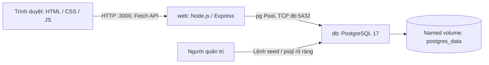

# Kiến trúc hệ thống

Frontend và API cùng origin nên không cần CORS. Express phục vụ thư mục `frontend/` bằng đường dẫn tính từ module, không phụ thuộc cwd hay đường dẫn máy Mac. Điều hướng dùng hash (`#overview`, `#students`, `#search`, `#transcript`), không cần frontend build.

`web` lắng nghe `0.0.0.0:3000` **bên trong container**. Compose ánh xạ `WEB_BIND_ADDRESS:WEB_PORT:3000`; mặc định host chỉ nhận `127.0.0.1:3000`. `db` chỉ có cổng nội bộ 5432, không publish lên host. Hai service dùng DNS `db` trên mạng mặc định của Compose. `localhost` trong `web` là container Web, không phải PostgreSQL.

Pool có `DB_POOL_MAX=10`, timeout lấy kết nối 5 giây, PostgreSQL statement timeout 15 giây, idle timeout 30 giây. Một tiến trình Node.js; không cluster, Redis hoặc result cache. Healthcheck Web gọi `/api/health`; database healthcheck dùng `pg_isready`. `depends_on: service_healthy` hỗ trợ thứ tự khởi động. Nếu DB mất kết nối sau đó, các request trả lỗi an toàn, pool loại bỏ connection chết và nhận connection mới ở request tiếp theo; server không crash vì lỗi idle client.

## Đường đi quan trọng

1. Tìm kiếm: validate mã → một `pool.query` tham số hóa → trả hồ sơ và hai số đo. SQL duy nhất nằm trong `backend/src/utils/queries.js`.
2. Danh sách: `ORDER BY id LIMIT $1 OFFSET $2`, lấy thêm một dòng để tính `has_next`, không COUNT. OFFSET đơn giản và ổn định với bộ dữ liệu chỉ đọc; trang rất sâu tốn nhiều công hơn. Đây không phải endpoint benchmark chính.
3. Bảng điểm: tìm sinh viên → JOIN `grades` / `subjects` theo ID → tính GPA có trọng số trên 6 dòng.
4. Tổng quan: một API COUNT khi mở dashboard lần đầu trong một lần tải trang; dữ liệu thống kê giữ trong bộ nhớ trình duyệt đến khi reload. Không gọi lại COUNT mỗi lần tra cứu.

## Vòng đời dữ liệu

`schema.sql` chỉ chạy qua PostgreSQL entrypoint khi named volume còn trống. Nó tạo các bảng và index `grades(student_id)`, không tạo sinh viên. Seed là lệnh quản trị riêng, trong một transaction và có kiểm tra trước COMMIT. Restart hay rebuild Web không seed/reset. PostgreSQL volume không nằm trong Git.

## Ranh giới

Không có endpoint tạo/xóa index, cập nhật điểm, đăng nhập hoặc seed HTTP. Tất cả hồ sơ là dữ liệu giả định và email `example.test`. Tài khoản PostgreSQL do image khởi tạo có quyền quản trị để phục vụ đồ án; không coi cấu hình demo này là mô hình phân quyền production. Hệ thống chứa dữ liệu thật cần xác thực, phân quyền, quản trị bí mật và ràng buộc duy nhất cho mã sinh viên.

Chỉ `idx_students_code` được thay đổi trong phép so sánh chính. Không đổi SQL, pool, worker, image, dataset hoặc cấu hình máy giữa BASELINE và OPTIMIZED. Không triển khai benchmark hay monitoring trong dự án này.
