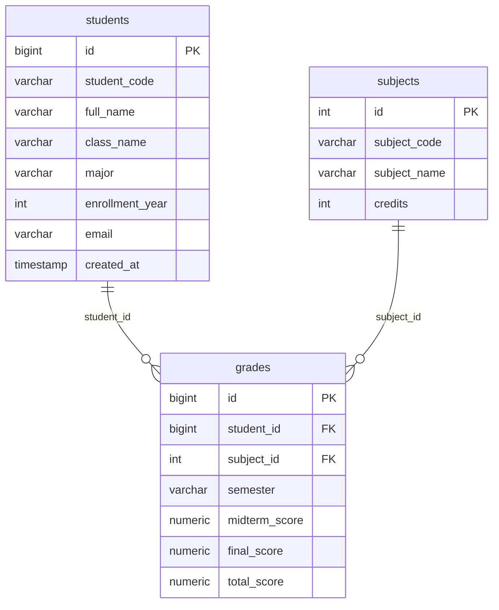

# Thiết kế và sinh dữ liệu PostgreSQL

Database mặc định `student_performance`, ba bảng:



## Dữ liệu xác định

`generate_series(1,N)` tạo sinh viên; họ/tên ghép từ danh sách giả định. ID liên tiếp, mã `SV` + ID 7 chữ số. Email `lower(student_code)@example.test`. Lớp chứa năm nhập học và viết tắt đúng ngành. Năm nhập học 2021–2024, học kỳ điểm cố định `2025-2026-HK2`; `created_at` seed cố định 2026-01-01 để tái lập dữ liệu. Trùng họ tên được phép; mã khác nhau. Không có dữ liệu cá nhân thật.

40 môn khai báo bằng mảng ngắn trong SQL. Môn 13–18 có 2 tín chỉ, các môn khác 3 tín chỉ.

Mỗi sinh viên có slot k=0..5:

```text
grade.id = (student_id - 1) * 6 + k + 1
subject_id = ((student_id - 1) * 7 + k * 3) % 40 + 1
midterm = ((student_id * 17 + k * 13) % 101) / 10
final   = ((student_id * 23 + k * 19) % 101) / 10
total   = round(midterm * 0.4 + final * 0.6, 2)
```

6 giá trị k khác nhau cho 6 môn khác nhau: chênh lệch tối đa 15, không thể chia hết cho 40. Điểm NUMERIC giữ phép toán thập phân chính xác. Score CHECK 0–10, credits >0, FK và PK bảo đảm quan hệ.

Quy mô chuẩn 100.000 / 200.000 / 300.000 / 500.000 / 1.000.000. Script cũng cho N=100..1.000.000 để smoke test nhỏ. Mặc định N=200.000, 40 môn, 1.200.000 điểm, tổng 1.400.040 bản ghi. Không dùng CSV/JSON lớn, vòng lặp Node hay Python để seed.

## Transaction và an toàn reset

Seed lấy khóa ghi trên ba bảng **chỉ trong thao tác khởi tạo dữ liệu**, không thực hiện trong request tìm kiếm hoặc khi benchmark. Seed bình thường từ chối nếu bất kỳ bảng nào đã có dữ liệu. `--reset-baseline RESET_BASELINE` là xác nhận xóa toàn bộ dữ liệu demo trong ba bảng, bỏ index thử nghiệm rồi sinh lại. Nếu INSERT/validate bị lỗi hoặc tiến trình chết trước COMMIT, transaction rollback; bộ dữ liệu cũ và index cũ được giữ nguyên. Lỗi sau COMMIT (ví dụ sinh file mã thất bại) không rollback dữ liệu đã commit; kiểm tra stats và chạy generator riêng.

`validate-data.sql` kiểm tra số lượng, mã theo ID, email, không trùng mã, đúng 6 môn khác nhau, điểm và công thức, học kỳ, orphan, index điểm, trạng thái index sinh viên. Sau seed chạy ANALYZE ba bảng. Mọi bước dùng `ON_ERROR_STOP` để lệnh shell trả mã lỗi thật. Full validation tốn tài nguyên, chạy ngoài thời gian đo.

## Index chủ động

BASELINE: students chỉ có `students_pkey(id)`, hoàn toàn không UNIQUE / composite / expression index khác trên students. `idx_grades_student_id(student_id)` luôn tồn tại. OPTIMIZED chỉ thêm `idx_students_code` B-tree không UNIQUE. Production nên có UNIQUE cho `student_code`; việc thiếu nó trong đồ án là thiết kế thí nghiệm có kiểm soát, không phải cấu hình được khuyến nghị cho hệ thống thật.

Reset tự bỏ index thử nghiệm đã biết, nhưng **từ chối và rollback** khi gặp index students khác ngoài PK để không âm thầm xóa thiết kế không thuộc thí nghiệm. Hãy kiểm tra `pg_indexes` và xử lý thủ công.

`create-index.sql` không thay đổi dữ liệu hoặc planner. `drop-index.sql` xác nhận không còn index phụ trên students. `database-stats.sql` in dung lượng heap/index/tổng từng bảng, DB tổng, index thử nghiệm hoặc ABSENT. PostgreSQL cache, OS cache, autovacuum và trạng thái thiết bị vẫn ảnh hưởng số đo dù SQL không đổi.
